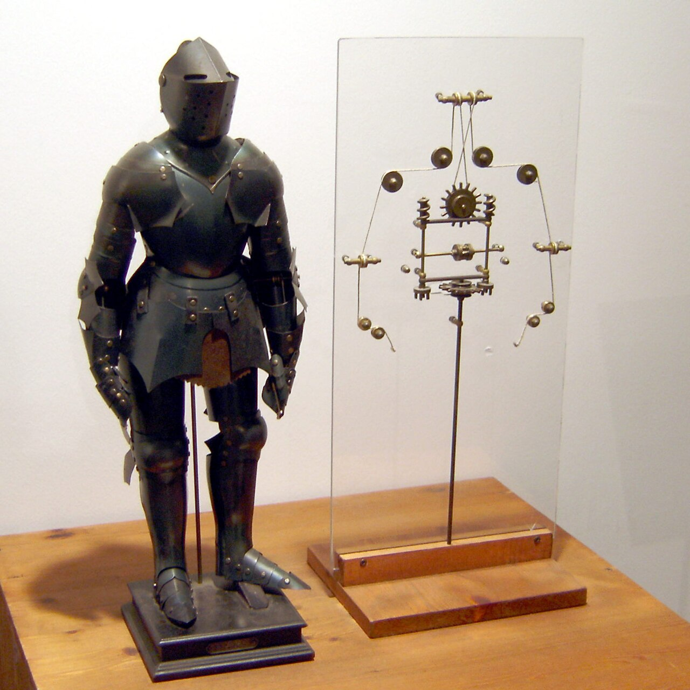
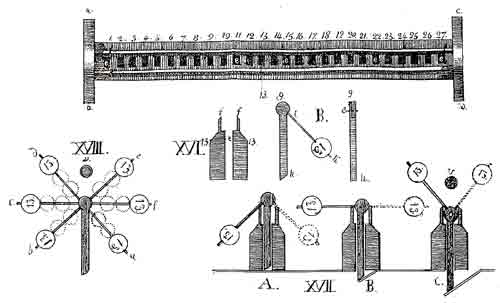
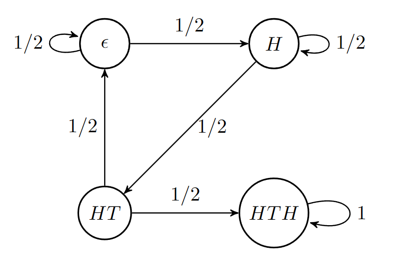
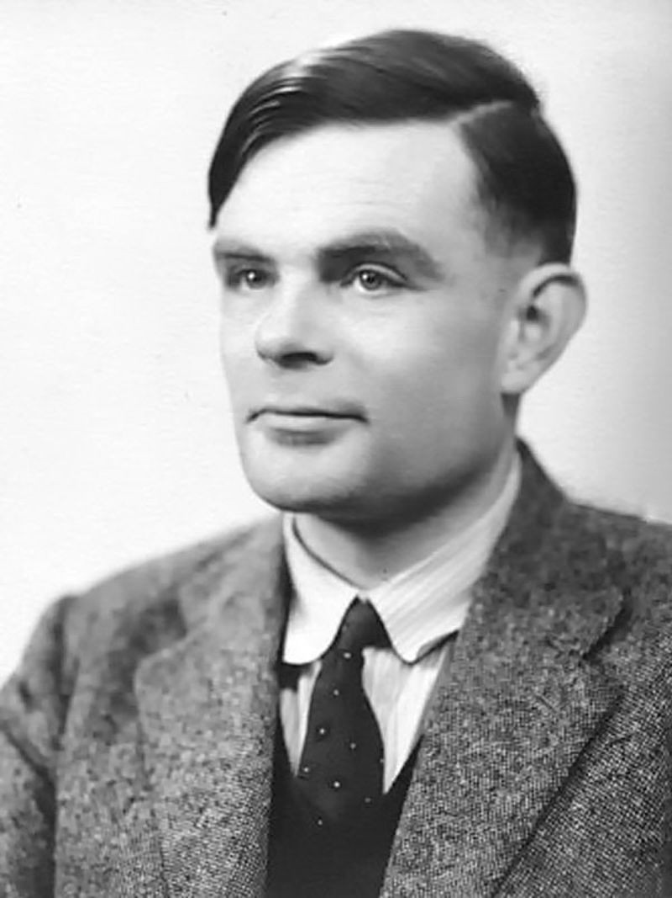
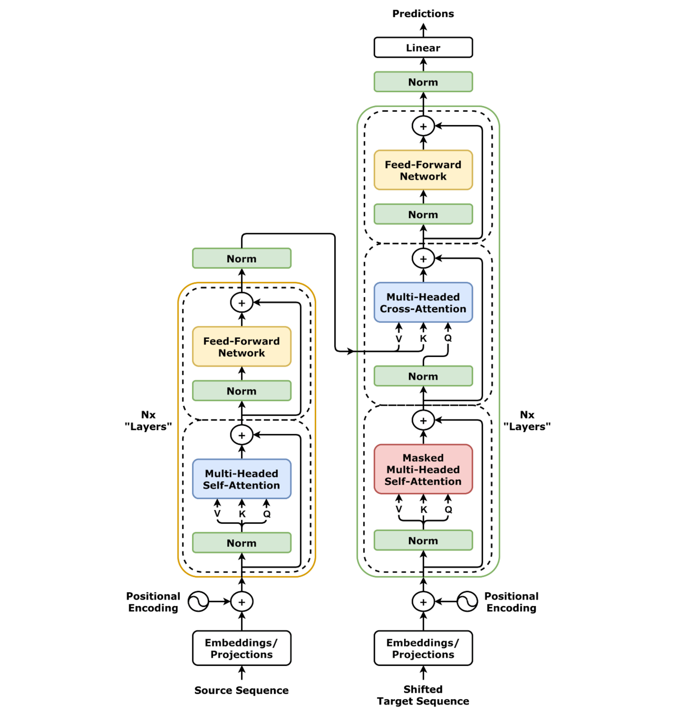

**Автор:** Бушуков Эмир · ORCID: [0009-0008-0877-2060](https://orcid.org/0009-0008-0877-2060)

Прежде чем погрузиться в математику современных LLM, полезно осознать: идея «машинного мышления» гораздо старше компьютеров. Понимание этой эволюции помогает увидеть, почему современные модели устроены именно так, а не иначе.

### Хронология ключевых фигур и открытий

Для удобства навигации приведем краткий таймлайн основных вех, сформировавших фундамент современных языковых моделей:

- **1495 | Леонардо да Винчи:** Концепт механического рыцаря — первая попытка физической имитации человеческого поведения.
- **1832 | Семён Корсаков:** Создание «интеллектуальных машин» (Идеоскоп) на перфокартах — прообраз баз данных и поиска по сходству.
- **1913 | Андрей Марков:** Математическое описание зависимых последовательностей (цепи Маркова) на примере текста Пушкина.
- **1936–1950 | Алан Тьюринг:** Формализация понятия алгоритма (Машина Тьюринга) и предложение поведенческого критерия ИИ (Тест Тьюринга).
- **1948 | Клод Шеннон:** Основание теории информации, статистическое моделирование языка (N-граммы).
- **1997 | Hochreiter & Schmidhuber:** Архитектура LSTM — решение проблемы «памяти» в нейросетях.
- **2017 | Vaswani et al. (Google):** Архитектура Transformer и механизм Self-Attention.
- **2018 | OpenAI & Google:** Появление GPT (генерация) и BERT (понимание).
- **2020 | Kaplan et al. (OpenAI):** Открытие Scaling Laws (законов масштабирования) и эра эмерджентных способностей.

***

### 1. Железный рыцарь Леонардо да Винчи

Идея «машинного мышления» гораздо старше электронных компьютеров. Ещё в 1495 году Леонардо да Винчи спроектировал механического рыцаря — автономное устройство, способное имитировать движения человека. Хотя это была чисто механическая анимация без вычислительной логики, она впервые поставила философский вопрос: _«Может ли машина имитировать поведение разумного существа?»_

*Механический рыцарь Леонардо да Винчи (реконструкция, выставка 2005 г.) — первый прообраз имитации поведения человека. Источник: [Wikimedia Commons](https://commons.wikimedia.org/wiki/File:Leonardo-Robot3.jpg), Public Domain.*

---

#### 2. Идеоскоп Корсакова

Однако первый шаг от механической имитации к **автоматизации логических операций** сделал русский ученый, изобретатель и статский советник Семён Николаевич Корсаков. В 1832 году, задолго до Чарльза Бэббиджа и Джорджа Буля, он сформулировал концепцию, которую сегодня мы называем **усилением интеллекта** (Intelligence Amplification, IA), и создал первые в истории механические устройства для обработки данных [1].

В основе философии Корсакова лежали три прогрессивных идеи:

1. **Ограниченность человеческой памяти:** Разум силен в суждениях, но слаб в удержании огромных массивов данных.
2. **Машина как помощник:** Цель устройств — не заменить человека, а освободить его от рутины поиска связей, позволив сосредоточиться на творчестве и выводах.
3. **Универсальный код:** Преобразование понятий и признаков в числовые коды для перфорированных карт.

Корсаков сконструировал пять аппаратов, решавших разные задачи обработки информации:

- **Идеоскоп (Idéoscope):** Самое сложное устройство для сравнения множества идей и признаков с помощью системы подвижных штырей и перфорированных листов.
- **Простой и Составной детерминаторы (Déterminateur simple/composé):** Механизмы для быстрого поиска объектов или целых классов понятий по заданному набору характеристик.
- **Сравнитель (Comparateur):** Устройство для сличения двух массивов данных и выявления пересечений.
- **Акропед (Acropède):** Прибор для классификации и определения места нового понятия в иерархической системе.

**Математическая логика Идеоскопа и связь с современным ИИ.** Корсаков применял свои машины на практике, в том числе для диагностики заболеваний и подбора лекарств в гомеопатии. Принцип работы Идеоскопа был гениально прост и математически точен:

1. _База знаний:_ В машину вставлялась таблица, где строками были болезни, а столбцами — симптомы. На пересечениях делались отверстия (перфорация).
2. _Запрос:_ Оператор выставлял штыри на планке напротив симптомов реального пациента.
3. _Результат:_ Планка накладывалась на таблицу. Там, где штыри свободно проходили сквозь отверстия, машина выдавала точное совпадение (логическое «И» / пересечение множеств). Если штырь упирался в картон, связь отсутствовала.

*С точки зрения современного Data Science, Идеоскоп Корсакова был механическим прототипом **бинарной фильтрации** и примитивного **поиска по сходству (similarity search)**. Сегодня мы решаем ту же задачу в RAG-системах (Retrieval-Augmented Generation), только вместо деревянных штырей и перфокарт используем векторные представления (эмбеддинги) и операцию скалярного произведения в многомерном пространстве.*

*Идеоскоп Семёна Корсакова (1832) — механический прообраз экспертных систем и поиска по сходству. Источник: [Wikimedia Commons](https://commons.wikimedia.org/wiki/File:Ideoscope.png), Public Domain.*

К сожалению, Петербургская Академия наук отклонила проект с вердиктом: _«Г-н Корсаков потратил слишком много разума на то, чтобы научить других обходиться без разума»_. Изобретения были забыты почти на полтора века, пока в 1961 году профессор МИФИ Георгий Поваров не обнаружил в архивах французскую брошюру Корсакова 1832 года, вернув его имя в мировую историю кибернетики [2]. Сегодня Семён Корсаков заслуженно признан пионером информатики, создавшим первый прообраз экспертных систем и баз данных.

---

#### 3. Как стихи Пушкина внесли вклад в развитие ИИ

Если Корсаков заложил основы _механического_ поиска данных, то русский математик Андрей Андреевич Марков дал нам математический аппарат для _статистического_ моделирования последовательностей.

В 1913 году Марков совершил революционный для своего времени эксперимент: он проанализировал первые 20 000 букв поэмы А.С. Пушкина «Евгений Онегин», игнорируя пробелы и знаки препинания. Марков подсчитал частоты перехода от одной буквы к другой (например, как часто после согласной идет гласная) и доказал, что эти переходы можно описать математически, даже если события зависимы.

Так родилась **цепь Маркова** — математическая модель, в которой вероятность следующего состояния зависит _только_ от текущего состояния, а не от всей предыдущей истории (это называется «свойством Маркова» или «марковским свойством»).

**Почему это критически важно для понимания LLM?** Современная генерация текста LLM — это, по сути, цепь Маркова колоссально высокого порядка.

- В классической цепи Маркова вероятность следующего слова зависит только от одного предыдущего слова (цепь 1-го порядка).
- N-граммы (о которых мы скажем ниже) — это цепи Маркова порядка N−1.
- Современные LLM пытаются преодолеть это ограничение, используя механизмы внимания (Attention), чтобы учитывать _весь_ контекст, но базовый принцип авторегрессии («предсказать следующее на основе предыдущего») остался неизменным со времен Маркова.

Именно Марков первым показал, что человеческий язык, несмотря на всю свою творческую сложность, подчиняется строгим статистическим закономерностям, которые можно вычислить.

*Иллюстрация цепи Маркова для генерации строк: следующее состояние зависит только от текущего. Источник: [Wikimedia Commons](https://commons.wikimedia.org/wiki/File:Markov_Chain_for_String_Generation_Example.png), CC BY-SA 4.0 (CeHaga).*

---

#### 4. Алан Тьюринг: Теория вычислений и смена парадигмы (1936–1950)

Прежде чем язык стал объектом статистического моделирования, необходимо было понять саму природу вычислений и то, как мы будем оценивать «разумность» машины. Эту задачу решил английский математик Алан Тьюринг. Его вклад фундаментален и двояк.

В 1936 году Тьюринг описал абстрактную «Машину Тьюринга», заложив теоретический фундамент для всех современных вычислительных устройств, включая GPU-кластеры, на которых сегодня обучаются LLM. Он доказал, что любой алгоритм можно свести к набору простых механических операций.

Однако для развития ИИ критически важной стала его статья 1950 года _«Computing Machinery and Intelligence»_ [3]. Тьюринг предложил радикальную смену парадигмы: вместо бесплодных философских споров о том, «может ли машина мыслить», он сформулировал практический критерий — **«Имитационную игру»** (сегодня известную как Тест Тьюринга). Суть теста проста: если человек-судья в текстовом диалоге не может отличить машину от другого человека, машину следует признать разумной.

**Почему это фундаментально для LLM?**

- **Для IT-специалиста:** Тьюринг первым предложил подход **black-box testing** (тестирование чёрного ящика) для интеллекта. Нам не важно, что происходит внутри системы (веса нейросети); мы оцениваем только соответствие входных и выходных данных (input/output) заданному паттерну.
- **Для врача:** Это аналог клинического подхода: мы ставим диагноз и оцениваем состояние пациента по наблюдаемым симптомам и поведению (фенотипу), а не по прямому наблюдению за работой отдельных нейронов мозга.

Современные LLM, по сути, являются первыми в истории системами, которые успешно проходят упрощённые версии теста Тьюринга. Они не «мыслят» в человеческом понимании, но они статистически безупречно _имитируют_ человеческий диалог, что и предсказал Тьюринг более 70 лет назад.

*Алан Тьюринг (1951) — автор «Машины Тьюринга» и теста Тьюринга. Источник: [Wikimedia Commons](https://commons.wikimedia.org/wiki/File:Alan_Turing_(1951).jpg), Public Domain (Elliott & Fry).*

---

#### 5. Эра статистики: N-граммы (1948-1990-е)

Клод Шеннон в 1948 году показал, что язык можно моделировать статистически.

**N-граммы** — это простейшая вероятностная модель, которая предсказывает следующее слово на основе предыдущих N-1 слов.

- _Пример:_ В модели 3-грамм (триграмм) вероятность слова «кофе» вычисляется на основе двух предыдущих слов: «утром я пью...» → «кофе» (высокая вероятность).

**Ограничения:**

- N-граммы не понимают контекст дальше N-1 слов.
- Они не обобщают — если модель не видела фразу «утром я употребляю...», она не сможет связать «употребляю» с «пью».
- Для больших N требуется колоссальный объём памяти.

N-граммы работали, но они были «слепы» к семантике и дальним зависимостям в тексте.

---

#### 6. Нейросетевая революция: RNN и LSTM (1990-2014)

В 1990-х годах исследователи обратились к рекуррентным нейронным сетям (Recurrent Neural Networks, RNN). Их ключевая идея — **память**. RNN обрабатывает текст последовательно, слово за словом, и на каждом шаге обновляет своё «внутреннее состояние» (hidden state), которое должно хранить информацию о предыдущих словах.

**Проблема длинных зависимостей:** Представьте предложение: _«Врач, который работал в этой больнице 20 лет назад и опубликовал множество статей по кардиологии, сегодня...»_ К тому моменту, когда RNN дойдёт до слова «сегодня», информация о «враче» уже давно «вымыта» из памяти новыми словами. RNN плохо запоминает длинные контексты.

**Решение: LSTM (Long Short-Term Memory, 1997).** Hochreiter и Schmidhuber предложили LSTM — архитектуру с механизмом «ворот», которая могла избирательно запоминать и забывать информацию. LSTM позволила работать с более длинными последовательностями и стала стандартом для задач NLP на полтора десятилетия.

**Ограничения LSTM:**

- Всё ещё последовательная обработка — нельзя параллелить вычисления (медленно на GPU).
- Информация всё равно «размывается» на очень длинных дистанциях.
- Двунаправленный контекст (одновременный учёт слов слева и справа) сложен для реализации.

---

#### 7. Прорыв 2017: Attention Is All You Need

В 2017 году группа исследователей из Google опубликовала статью, которая перевернула всю область. Они предложили архитектуру **Transformer**, полностью отказавшуюся от рекуррентности.

**Ключевая идея: Self-Attention (самовнимание).** Вместо того чтобы читать текст последовательно, Transformer «смотрит» на все слова в предложении одновременно и вычисляет, насколько каждое слово связано с каждым другим.

_Аналогия для врача:_ Представьте, что вы читаете историю болезни. Когда вы доходите до слова «назначить», вам не нужно помнить все предыдущие слова подряд — вы просто «бросаете взгляд» назад и видите, что речь шла о «пациенте с гипертонией». Self-Attention работает так же: для каждого слова модель вычисляет «веса внимания» ко всем остальным словам в контексте.

**Преимущества Transformer:**

1. **Параллелизация:** Все слова обрабатываются одновременно, что идеально для GPU.
2. **Дальние зависимости:** Модель может напрямую связать первое и последнее слово в длинном тексте.
3. **Масштабируемость:** Архитектура позволяет увеличивать количество параметров до сотен миллиардов.

*Полная архитектура Трансформера из статьи «Attention Is All You Need» (2017). Источник: [Wikimedia Commons](https://commons.wikimedia.org/wiki/File:Transformer,_full_architecture.png), CC BY 4.0 (dvgodoy).*

---

#### 8. Два пути развития: GPT и BERT (2018)

После публикации Transformer исследователи пошли двумя путями:

**GPT (Generative Pre-trained Transformer, OpenAI, 2018)**

- _Направление:_ Генерация текста.
- _Обучение:_ Модель учится предсказывать следующее слово (авторегрессия, как мы описали в Главе 2).
- _Контекст:_ Использует только «левый» контекст (слова до текущего).
- _Применение:_ Генерация текста, диалоговые системы, написание кода.

**BERT (Bidirectional Encoder Representations from Transformers, Google, 2018)**

- _Направление:_ Понимание текста.
- _Обучение:_ Модель учится заполнять пропущенные слова (Masked Language Modeling).
- _Контекст:_ Использует и «левый», и «правый» контекст одновременно.
- _Применение:_ Классификация текста, извлечение сущностей, поиск, ответ на вопросы.

**Важно для практики:** Когда вы работаете с ChatGPT, Claude, LLaMA — это GPT-подобные модели (генеративные). Когда вы используете модели для поиска в документации или классификации документов — это часто BERT-подобные модели (энкодеры).

---

#### 9. Эра масштабирования: Scaling Laws (2020-наши дни)

С 2020 года началась эра, которую можно назвать «индустриальной гонкой вооружений». Исследователи из OpenAI опубликовали работу **Scaling Laws for Neural Language Models** (2020), которая показала удивительный эмпирический факт:

> _Производительность LLM предсказуемо и плавно улучшается с увеличением трёх факторов:_
>
> 1. _Количества параметров модели (N)_
> 2. _Объёма данных для обучения (D)_
> 3. _Вычислительных ресурсов (C)_

**Эмерджентные способности (Emergent Abilities):** При достижении определённого масштаба (сотни миллиардов параметров) у моделей внезапно появляются способности, которых не было у меньших версий:

- Решение арифметических задач в несколько шагов.
- Написание работающего кода по словесному описанию.
- Способность следовать сложным инструкциям (InstructGPT, 2022).

Именно масштабирование превратило LLM из «статистических попугаев» в системы, способные решать сложные рассуждательные задачи. Но это же масштабирование создало проблемы: обучение GPT-4, по оценкам, стоило более $100 миллионов и потребовало тысяч GPU.

---

### Резюме главы

Эволюция NLP — это история борьбы с **контекстом** и **масштабом**:

1. **N-граммы** видели только несколько слов вокруг.
2. **RNN/LSTM** пытались «запомнить» контекст, но теряли его на длинных дистанциях.
3. **Transformer** решил проблему, позволив модели «видеть» весь контекст одновременно через механизм внимания.
4. **Scaling Laws** показали, что при достаточном масштабе статистические закономерности порождают поведение, которое мы называем «интеллектом».

Понимание этой эволюции критически важно для практической работы: когда вы выбираете между GPT-подобной и BERT-подобной моделью, когда вы настраиваете длину контекста, когда вы решаете, нужна ли вам модель на 7B или 70B параметров — вы опираетесь на эти фундаментальные принципы.

***

---

### Источники и литература (References):

1. **Korsakov, S. N. (1836).** _Опыт наставления к изучению наук и особенно к практическому сведению оных._ _Комментарий: Оригинальная работа Корсакова, описывающая его «машину для сравнения идей». Исторический контекст предтеч ИИ._
2. **Shannon, C. E. (1948).** _A Mathematical Theory of Communication._ Bell System Technical Journal. _Комментарий: Фундаментальная работа, заложившая основы теории информации и статистического моделирования языка._
3. **Hochreiter, S., & Schmidhuber, J. (1997).** _Long Short-Term Memory._ Neural Computation, 9(8), 1735-1780. _Комментарий: Оригинальная статья, предлагающая LSTM. Ключевая работа для понимания эволюции до Transformer._
4. **Vaswani, A., et al. (2017).** _Attention Is All You Need._ Advances in Neural Information Processing Systems (NeurIPS). _Комментарий: Статья, представившая архитектуру Transformer. Основа всех современных LLM._ (arXiv:1706.03762)
5. **Radford, A., et al. (2018).** _Improving Language Understanding by Generative Pre-Training._ OpenAI. _Комментарий: Оригинальная работа по GPT-1. Описывает генеративный подход к предобучению языковых моделей._
6. **Devlin, J., et al. (2018).** _BERT: Pre-training of Deep Bidirectional Transformers for Language Understanding._ arXiv preprint. _Комментарий: Работа, представившая BERT. Ключевая для понимания двунаправленного подхода к обработке языка._ (arXiv:1810.04805)
7. **Kaplan, J., et al. (2020).** _Scaling Laws for Neural Language Models._ arXiv preprint. _Комментарий: Эмпирическое исследование, показавшее предсказуемую зависимость производительности LLM от масштаба. Основа для понимания современной эры масштабирования._ (arXiv:2001.08361)
