**Автор:** Бушуков Эмир · ORCID: [0009-0008-0877-2060](https://orcid.org/0009-0008-0877-2060)

## Цель данной статьи

Сформировать шаги по установке, подготовке данных для тестирования и протестировать работу AI-моделей для медицинской диагностики.
В данной статье будет рассмотрена работа medgemma 27b от Google.

## Дисклеймер

Любой вывод — предварительный и требует независимой верификации.
**Галлюцинации возможны** даже на доменных данных; обязателен ручной контроль.

**Валидация обязательна:** производитель требует проверять модель на данных, репрезентативных для вашей задачи (возраст, пол, тип сканера, учреждение).

**Персональные данные:** не загружайте не-обезличенные снимки/медкарты пациентов — локальная модель снимает вопрос утечки в облако, но не отменяет требования локальных регламентов (HIPAA/152-ФЗ и т.п.).

**Лицензия модели:** Health AI Developer Foundations Terms of Use — коммерческое использование и условия распространения нужно сверять с текстом лицензии.

Автор статьи не несёт ответственность за ошибочные заключения модели; статья написана в исключительно ознакомительных целях.

## План работ

1. что такое medgemma 27b
2. характеристики стенда для тестирования
3. установка ollama
4. установка модели medgemma 27b
5. установка docker
6. установка docker container Open WebUI
7. настройка подключения Open WebUI к medgemma 27b
8. подготовка тестовых входных данных
9. тестирование
10. Анализ результатов заключения модели


### 1. Что такое medgemma 27b

**MedGemma** — семейство открытых мультимодальных моделей (LLM) для медицинских задач, разработанное **Google** в рамках программы **Health AI Developer Foundations (HAI-DF)**. Модель построена на базе **Gemma 3** и дообучена на медицинских данных. [wikipedia](https://en.wikipedia.org/wiki/Gemma_(language_model))

#### Кто и как обучал

- **Автор:** Google (Health AI Developer Foundations), сборка через Ollama — `ollama.com/library/medgemma`.
- **Базовая архитектура:** Gemma 3 ([Gemma 3 Technical Report, arXiv:2503.19786](https://arxiv.org/abs/2503.19786)) + **SigLIP** — визуальный энкодер, специально предобученный на **деидентифицированных** медицинских изображениях: рентген грудной клетки, дерматоскопия, офтальмоскопия (фундус-снимки), гистопатология. Медицинский вариант энкодера вынесен в отдельную модель **MedSigLIP** ([model card](https://developers.google.com/health-ai-developer-foundations/medsiglip/model-card)).
- **LLM-часть дообучена** на: медицинский текст, пары «вопрос–ответ», данные электронных медкарт в формате **FHIR** (только 27B), радиологические снимки, гистопатологические патчи, офтальмологические и дерматологические изображения.
- **Варианты:** 4B (multimodal, `-pt`/`-it`) и 27B (multimodal и text-only). Версии 27B доступны только в instruction-tuned варианте.
- **Релизы:** 4B и 27B text-only — 20 мая 2025; **27B multimodal — 9 июля 2025** (после исправления бага с токеном изображения, июль 2025).

**Статьи и технические отчёты:**

| Документ | Что внутри |
|---|---|
| [MedGemma Technical Report, arXiv:2507.05201](https://arxiv.org/abs/2507.05201) (Sellergren et al., 07.07.2025, 81 автор) | Полное описание обучения MedGemma 4B/27B и MedSigLIP, бенчмарки |
| [MedGemma 1.5 Technical Report, arXiv:2604.05081](https://arxiv.org/abs/2604.05081) (06.04.2026) | Следующее поколение: объёмные КТ/МРТ, WSI-гистопатология, локализация bounding boxes |
| [Model card MedGemma](https://developers.google.com/health-ai-developer-foundations/medgemma/model-card-v1) | Назначение, оценки, ограничения, release notes |
| [Hugging Face: google/medgemma-27b-it](https://huggingface.co/google/medgemma-27b-it) | Веса, карточка модели, примеры запуска через Transformers |
| [Health AI Developer Foundations](https://developers.google.com/health-ai-developer-foundations/medgemma) (goo.gle/hai-def) | Программа Google, условия использования, связанные модели (MedSigLIP, TxGemma, HeAR) |
| [MedGemma в Ollama](https://ollama.com/library/medgemma) | Сборки для локального запуска |

**Результаты обучения (из технических отчётов):**

- **MedGemma (1)** значительно превосходит генеративные модели сопоставимого размера и приближается к специализированным моделям, сохраняя общие способности Gemma 3. На out-of-distribution задачах относительно базовых моделей Gemma 3:
  - **+2,6–10%** — медицинский мультимодальный VQA;
  - **+15,5–18,1%** — классификация находок на рентгене грудной клетки;
  - **+10,8%** — agentic-оценки;
  - до **−50% ошибок** при извлечении данных из электронных медкарт после файн-тюнинга; сопоставимость с SOTA в классификации пневмоторакса и гистопатологических патчей.
- **MedGemma 1.5 4B** (2026): +11% к точности классификации 3D МРТ, +3% к 3D КТ, +47% macro-F1 в гистопатологии (WSI) по сравнению с MedGemma 1 4B; добавлены работа с объёмами КТ/МРТ и анализ снимков в динамике.

> Подробнее: [model card MedGemma](https://developers.google.com/health-ai-developer-foundations/medgemma/model-card-v1), [MedGemma в Ollama](https://ollama.com/library/medgemma).

#### Особенности

| Особенность       | Описание                                                                                                                                                                                    |
| ----------------- | ------------------------------------------------------------------------------------------------------------------------------------------------------------------------------------------- |
| Вход              | Текст **и изображения** (multimodal): `capabilities: completion, vision`                                                                                                                    |
| Задачи            | VQA по снимкам («что вы видите на КТ»), медицинские вопросы, разбор медкарт, рассуждение                                                                                                    |
| Оценка            | Превосходит базовую Gemma 3 на всех протестированных мед. бенчмарках <br>(MedQA, PubMedQA, MedXpertQA, PathMCQA, US-DermMCQA, EyePACS и др., 22+ датасетов, 6 задач, 4 модальности снимков) |
| Лицензия          | Health AI Developer Foundations Terms of Use (не Apache/MIT)                                                                                                                                |
| Тонкость промптов | Чувствительнее к формулировке промпта, чем исходная Gemma 3                                                                                                                                 |
| Не оценивалось    | Мульти-картинные сценарии, длинные multi-turn диалоги                                                                                                                                       |


### 2. Характеристики стенда для тестирования


Статья проверена на следующей конфигурации:

| Компонент | Значение |
|---|---|
| CPU | AMD Ryzen 5 5600, 6 ядер / 12 потоков, до 4.47 ГГц |
| ОЗУ | 32 ГБ (DDR4) + swap 22 ГБ |
| GPU | NVIDIA GeForce RTX 3060, **12 ГБ VRAM** (GA106), драйвер 595.84, CUDA 13.2 |
| Накопители | NVMe: 137 ГБ (`/`), 623 ГБ (`/home`) |
| ОС | Ubuntu 24.04.5 LTS |
| Ollama | v0.34.0 |
| Docker | 29.7.1 + Compose plugin |
| Open WebUI | `ghcr.io/open-webui/open-webui:main` |
| Модель | `medgemma:27b` — 17 GB, Q4_K_M, context 131072 |

**Важно по памяти:** вес модели (~17 ГБ в Q4_K_M) **больше VRAM RTX 3060 (12 ГБ)** — Ollama автоматически держит часть весов в VRAM, остальное свапит в ОЗУ. С 32 ГБ ОЗУ это работает, но скорость ниже, чем если бы модель целиком помещалась в GPU. Полностью в GPU помещается вариант `medgemma:4b` (~3.3 ГБ).


### 3. Установка Ollama

Что такое ollama — [wikipedia](https://en.wikipedia.org/wiki/Ollama).
Официальный сайт [ollama](https://ollama.com/)

Как установить для различных OS [link](https://ollama.com/download)

Проверка:

```bash
ollama --version
systemctl status ollama          # active (running)
curl http://localhost:11434/api/tags   # {"models":[]}
```

Ollama по умолчанию слушает на `127.0.0.1:11434` — этого достаточно для локального CLI, но **недостаточно для контейнера Docker**; в последующем будем донастраивать.


### 4. Установка модели medgemma 27b

Выполнить в терминале:

```bash
ollama pull medgemma:27b     # скачивание ~17 GB
ollama show medgemma:27b     # параметры модели
```

Проверка:

```bash
ollama show medgemma:27b
#   architecture        gemma3
#   parameters          27.4B
#   context length      131072
#   quantization        Q4_K_M
#   Capabilities: completion, vision
```

**Что значит 27B** — **27 billion parameters**, то есть в модели ~27 миллиардов весов (фактически по `ollama show`: 27.4B параметров). Чем больше параметров, тем:

- выше качество рассуждений и понимание снимков;
- больше требование к памяти и ниже скорость на одном и том же железе.

| | `medgemma:4b` | `medgemma:27b` |
|---|---|---|
| Параметры | ~4 млрд | ~27.4 млрд |
| Размер файла | ~3.3 ГБ | ~17 ГБ (Q4_K_M) |
| VRAM/ОЗУ | помещается в 8–12 ГБ GPU | нужно 20+ ГБ памяти суммарно |
| Скорость | высокая | существенно ниже на среднем GPU |
| Применение | скрининг, черновики, мобильные сценарии | финальные ответы, сложные кейсы |


### 5. Установка docker

Официальный сайт установки docker на различные OS [link](https://docs.docker.com/engine/install/)

Проверка:

```bash
docker --version
docker run --rm hello-world
```


### 6. Установка docker container Open WebUI

```bash
docker run -d -p 3000:8080 \
  --add-host=host.docker.internal:host-gateway \
  -v open-webui:/app/backend/data \
  -e OLLAMA_BASE_URL=http://host.docker.internal:11434 \
  --name open-webui \
  --restart always \
  ghcr.io/open-webui/open-webui:main
```

Разбор ключевых параметров:

| Параметр | Зачем |
|---|---|
| `-p 3000:8080` | веб-интерфейс на `http://localhost:3000` |
| `--add-host=host.docker.internal:host-gateway` | имя хоста внутри контейнера, указывающее на машину |
| `-e OLLAMA_BASE_URL=http://host.docker.internal:11434` | адрес Ollama **изнутри** контейнера: имя хоста + порт |
| `-v open-webui:/app/backend/data` | персистентные данные (пользователи, чаты, модели) |

> ⚠️ Типичные ошибки: `http://docker.internal` (несуществующее имя вместо `host.docker.internal`) и адрес без порта `11434`. Переменные окружения применяются только при **пересоздании** контейнера — `docker restart` их не подхватывает:

```bash
docker rm -f open-webui
docker run -d ...   # повторить команду выше
```

Первый вход: `http://localhost:3000` → первый зарегистрированный пользователь становится администратором.


### 7. Настройка подключения Open WebUI к medgemma 27b

Настроить порт для подключения

```bash
sudo systemctl edit ollama.service
# добавить между комментариями:
[Service]
Environment="OLLAMA_HOST=0.0.0.0:11434"
sudo systemctl daemon-reload && sudo systemctl restart ollama
```

Настроить firewall, если он включён:

```bash
sudo ufw status | grep 11434 || sudo ufw allow 11434/tcp
```

Проверка:

```bash
curl http://localhost:11434/api/tags          # список моделей, среди них medgemma:27b
curl http://172.17.0.1:11434/api/tags         # то же по адресу docker-моста

docker logs open-webui 2>&1 | grep -i ollama
# в логах НЕ должно быть: Connection error / Connect call failed / connection refused
```

Проверка в интерфейсе

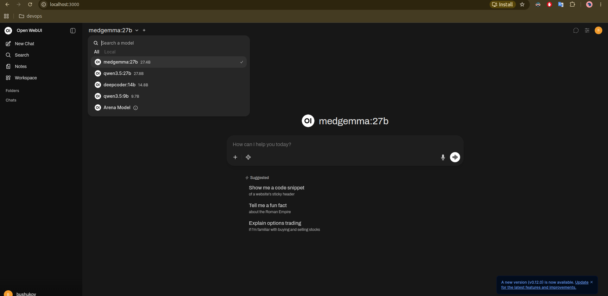


### 8. Подготовка тестовых входных данных

В качестве тестовых данных в данной статье будем использовать статические снимки МРТ, КТ различных органов с патологией и без патологии.

Прямая ссылка на файл [link](https://openneuro.org/datasets/ds007212/versions/1.0.0/files/sub-0354/anat/sub-0354_T1w.nii.gz)

####  Источники и лицензии

| Датасет  | DOI                                                                                          | Авторы                                             | Лицензия |
| -------- | -------------------------------------------------------------------------------------------- | -------------------------------------------------- | -------- |
| ds007212 | [doi:10.18112/openneuro.ds007212.v1.0.0](https://doi.org/10.18112/openneuro.ds007212.v1.0.0) | Truzman T., Halai A.D., Lambon Ralph M.A. (2025)   | CC0      |
| ds008813 | [doi:10.18112/openneuro.ds008813.v1.1.0](https://doi.org/10.18112/openneuro.ds008813.v1.1.0) | Martinez-Soto J., Gonzalez-Santos L., Barrios F.A. | CC0      |

- OpenNeuro: [https://openneuro.org/](https://openneuro.org/)
- Датасет с очагами: [https://openneuro.org/datasets/ds007212](https://openneuro.org/datasets/ds007212)
- Датасет нормы: [https://openneuro.org/datasets/ds008813](https://openneuro.org/datasets/ds008813)
- Документация OpenNeuro: [https://docs.openneuro.org/](https://docs.openneuro.org/)

Для тестирования `medgemma:27b` в статье использованы **10 аксиальных МРТ-срезов** головного мозга:
**5 с очаговой патологией** и **5 без патологии**. Источник — открытый репозиторий
[OpenNeuro](https://openneuro.org/). Все скачанные данные — под лицензией **CC0** (public domain).

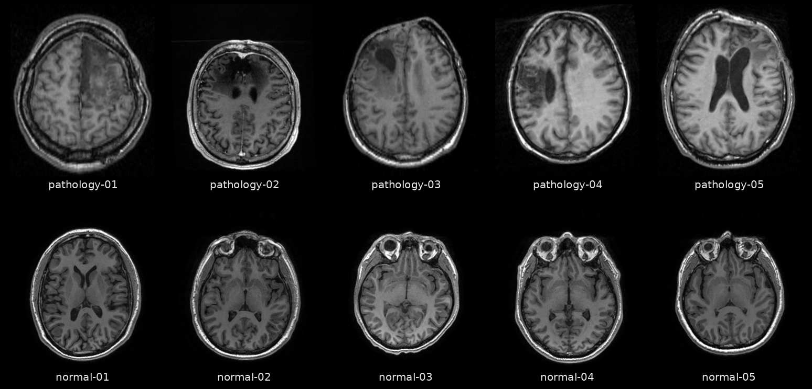

Контактный лист: верхний ряд — 5 патологических, нижний ряд — 5 нормальных.

Датасет CCNRP (Кембридж) — ретроспективная коллекция **деидентифицированных** структурных МРТ (T1w)
пациентов с **хроническими очаговыми поражениями головного мозга**. По официальному README датасета:

- **204 участника**, каждому соответствует свой T1w-объём;
- к каждому снимку приложена **бинарная маска очага** (`label-lesion_roi`), размеченная вручную
  старшим неврологом (MRIcron), в том же нативном пространстве, что и T1w;
- очаги **хронические, немалигнизирующие**, гетерогенной этиологии: **ишемический инсульт** и
  **хирургические резекции** (точная причина по каждому участнику не раскрыта);
- демографические и клинические переменные (пол, возраст, этиология) **не опубликованы**;
- все снимки **дефасированы** (удалено лицо).

Для тестирования отобраны **5 участников с самыми крупными очагами** и хорошим изотропным
разрешением (~1 мм, сетка 182×218×182 или 256×256×252). Сторона очага: **3 левых / 2 правых**.

| # | Файл | Участник | Сторона | Объём очага, см³ | Аксиальный срез (z) | Центроид (RAS, мм) |
|---|---|---|---|---|---|---|
| 01 | `pathology-01.png` | sub-0354 | **правый** | 214,0 | 118 | (20, 12, 34) |
| 02 | `pathology-02.png` | sub-3161 | **левый** | 179,6 | 181 | (−8, 27, 29) |
| 03 | `pathology-03.png` | sub-0097 | **левый** | 167,6 | 105 | (−27, 18, 37) |
| 04 | `pathology-04.png` | sub-0023 | **левый** | 158,3 | 103 | (−44, −6, 17) |
| 05 | `pathology-05.png` | sub-0715 | **правый** | 120,7 | 96 | (28, 35, 34) |

**Ориентировочная локализация** (по координатам центроида, RAS: x — влево/вправо, y — кзади/кпереди,
z — ниже/выше; аффины архивных данных могут отличаться от MNI, поэтому локализация приблизительная):

| # | Ориентировочно |
|---|---|
| 01 | правое полушарие, лобно-центральная область (глубоко) |
| 02 | левое полушарие, медиальные отделы лобной доли / поясная область |
| 03 | левая лобная доля, верхние отделы |
| 04 | левая височно-теменно-островковая область (латерально) |
| 05 | правая лобная доля |


### 9. Тестирование модели

Промт:

```md

Роль: Ты — высококвалифицированный врач-радиолог с многолетним опытом анализа нейровизуализационных данных. Тебе предоставлен МРТ-срез головного мозга нового пациента.

Твоя задача — провести последовательный и объективный анализ изображения, строго опираясь только на визуальные данные.

Перед ответом активируй свои знания по нейроанатомии, паттернам МРТ-сигналов (T1, T2, FLAIR, ДВИ и др.) и радиологическим признакам патологий головного мозга.

Сформируй заключение строго по следующим пунктам:

1. Оценка качества изображения: Насколько понятен снимок? Оцени качество визуализации, разрешение, наличие артефактов (движение, металлические наводки и т.д.) и пригодность снимка для точной диагностики.
2. Наличие или отсутствие патологии: Четко укажи, обнаружены ли изменения или снимок соответствует возрастной норме. Если патологий нет — так и напиши, завершив описание на этом пункте.
3. Локализация (если выявлена патология): Укажи точное анатомическое расположение (полушарие, доля, глубинное вещество, стволовые структуры, желудочки, оболочки и т.д.) и сторону поражения (справа/слева/билатерально).
4. Характер и характеристики изменений: Опиши интенсивность МР-сигнала, форму, контуры, размеры, структуру очага/образования, а также наличие масс-эффекта или перифокального отека.
5. Дифференциальный диагноз и возможные причины: Назовите наиболее вероятные патологические процессы (сосудистые, воспалительные, неопластические, демиелинизирующие и т.д.), которые могут давать подобную картину.
6. Дальнейшие рекомендации: Что необходимо сделать для уточнения диагноза? (Например: МРТ с контрастированием, КТ, ангиография, консультация невролога/нейрохирурга, динамическое наблюдение через X месяцев).

Важные правила и ограничения:
- Принцип «Не уверен — не утверждай»: Если качество снимка или ракурс не позволяют однозначно определить структуру, прямо напиши: «Данный участок визуализируется нечетко, интерпретация затруднена». Не пытайся додумывать или фантазировать.
- Клиническая ответственность: Не ставь окончательный диагноз, формулируй мысли в виде радиологического заключения и дифференциального ряда.
- Пиши профессиональным медицинским языком, последовательно и лаконично.

```


#### Анализ снимка pathology-01

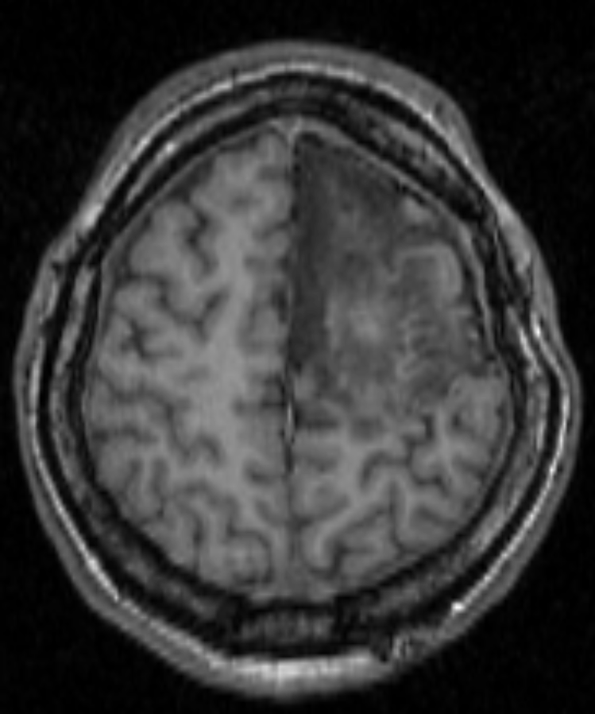{width=60%}


```md
## Радиологическое заключение по МРТ головного мозга

**1. Оценка качества изображения:**

Снимок представляет собой аксиальный срез головного мозга, вероятно, выполненный по T2-взвешенной последовательности (судя по гиперинтенсивности спинномозговой жидкости и гипоинтенсивности костного строма). Качество визуализации удовлетворительное, разрешение позволяет оценить основные анатомические структуры. Присутствуют незначительные артефакты движения, но они не критичны для интерпретации. Снимок пригоден для первичной оценки.

**2. Наличие или отсутствие патологии:**

Обнаружены патологические изменения.

**3. Локализация:**

Патологический очаг локализован в левом полушарии, в области подкорковых структур, вероятно, в глубине белого вещества, смещен к латеральной стороне.

**4. Характер и характеристики изменений:**

Очаг имеет неправильную, неровную форму. Контуры нечеткие. Размеры очага составляют приблизительно 2-2.5 см в наибольшем диаметре. Интенсивность сигнала на представленном T2-взвешенном изображении повышена (гиперинтенсивный), что говорит о повышенном содержании воды. Визуализируется перифокальный отек, проявляющийся в виде зоны гиперинтенсивности вокруг очага. Присутствует масс-эффект, проявляющийся в виде смещения близлежащих структур (вероятно, бокового желудочка) в противоположную сторону.

**5. Дифференциальный диагноз и возможные причины:**

Учитывая локализацию, размеры, нечеткие контуры, повышенный сигнал на T2-взвешенных изображениях, наличие перифокального отека и масс-эффекта, можно предположить следующие варианты:

*   **Новообразование:** Первичная опухоль мозга (например, глиома, медуллобластома) или метастатическое образование.
*   **Воспалительное/инфекционное поражение:** Абсцесс головного мозга (особенно если есть клинические признаки инфекции).
*   **Демиелинизирующее заболевание:** Распространенная форма рассеянного склероза, хотя размеры и выраженный масс-эффект менее типичны.
*   **Инфаркт мозга:** Реже, особенно если нет четкой зоны гипоинтенсивности на DWI (если таковое изображение есть). Однако, обширный инфаркт с отеком и масс-эффектом может выглядеть подобным образом.

**6. Дальнейшие рекомендации:**

Для уточнения диагноза и определения дальнейшей тактики лечения необходимы следующие исследования:

*   **МРТ головного мозга с контрастным усилением (гадолинием):** Для оценки васкуляризации очага, выявления зон некроза и определения характера усиления сигнала (однородное, неравномерное, кольцевидное), что поможет дифференцировать новообразование, абсцесс и другие процессы.
*   **МРТ с диффузионно-взвешенной последовательностью (DWI):** Для исключения острого инсульта.
*   **МРТ с перфузионно-взвешенной последовательностью (PWI):** Для оценки васкуляризации очага, что может помочь в дифференциальной диагностике опухолей.
*   **Консультация невролога и/или нейрохирурга:** Для оценки клинической картины, планирования дальнейшего обследования (например, биопсии) и определения тактики лечения.

На основании представленного снимка невозможно поставить окончательный диагноз. Требуется проведение дополнительных исследований.
```


#### Анализ снимка pathology-02

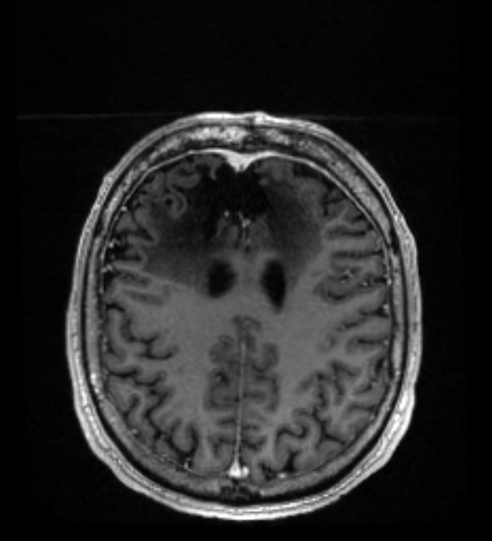{width=60%}

```md
Приветствую! Я готов проанализировать предоставленное изображение МРТ головного мозга.

**1. Понятность снимка и качество изображения:**

*   Снимок представляет собой аксиальный (горизонтальный) срез головного мозга, вероятно, на уровне таламуса/базальных ганглиев.
*   Качество изображения хорошее. Визуализируются основные структуры: полушария, желудочки (боковые, третий), базальные ганглии (пунктаты, хвостатое ядро, скорлупа), таламусы, ствол мозга.
*   Хорошо видна разница в интенсивности сигнала между серым и белым веществом, а также между мозгом и спинномозговой жидкостью (ликвором) в желудочках и субарахноидальном пространстве.

**2. Наличие патологии:**

*   Да, на снимке четко видна патология.
*   Обнаружено объемное образование (опухолевидное образование) в области базальных ганглиев и таламуса.
*   Образование имеет неровные контуры и неоднородную структуру.
*   Визуализируется выраженный перифокальный отек (зона отека вокруг образования).
*   Образование смещает окружающие структуры, в частности, боковой желудочек.

**3. Сторона локализации:**

*   Образование локализуется в **левой** половине головного мозга, затрагивая левый таламус и базальные ганглии.

**4. Характер изменений:**

*   Объемное образование (опухолевидное).
*   Неоднородная структура.
*   Выраженный перифокальный отек.
*   Смещение окружающих структур (бокового желудочка).
*   Возможны признаки некроза или кровоизлияния внутри образования (сложно оценить по одному срезу).

**5. Возможные причины патологий:**

*   Учитывая локализацию и характер изменений (объемное образование с отеком), наиболее вероятные причины:
    *   **Опухоль головного мозга:**
        *   Первичная опухоль: глиома (например, глиобластома, астроцитома), менингиома (менее вероятно в этой локализации), лимфома.
        *   Метастатическая опухоль (если у пациента есть анамнез онкологического заболевания).
    *   **Абсцесс головного мозга:** Гнойное воспаление, которое может выглядеть как объемное образование с отеком.
    *   **Кровоизлияние:** Старый гематомный очаг с перифокальным отеком и разрешением.
    *   **Воспалительное заболевание:** Например, демиелинизирующие заболевания (рассеянный склероз, но обычно множественные очаги), васкулит.
    *   **Редкие причины:** Кисты, паразитарные поражения.
*   Для уточнения диагноза необходимы дополнительные исследования и клиническая информация.

**6. Дальнейшие рекомендации:**

*   **МРТ головного мозга с контрастным усилением:** Необходимо для оценки васкуляризации образования (опухоли часто контрастируются, абсцессы тоже, но могут быть и неконтрастирующими).
*   **МРТ всего головного мозга:** Для исключения множественных очагов (метастазы, рассеянный склероз).
*   **МРТ с использованием специализированных последовательностей:** Например, перфузионная МРТ, спектроскопия МРТ (MRS), DTI (диффузионно-тензорная визуализация) для получения дополнительной информации о характере образования.
*   **Консульта
```

#### Анализ снимка pathology-03

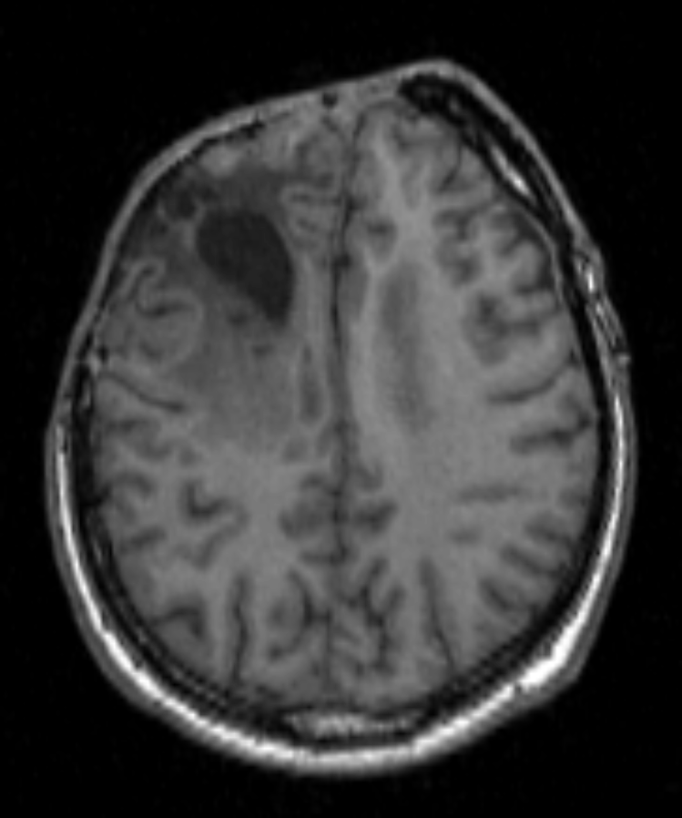{width=60%}

```md
## Радиологическое заключение по МРТ головного мозга

**1. Оценка качества изображения:**

Снимок представляет собой аксиальный (горизонтальный) срез головного мозга. Качество изображения удовлетворительное. Визуализируются основные структуры: полушария, желудочки, мозжечок (частично), ствол мозга. Разрешение позволяет оценить структуру ткани мозга и выявить грубые патологии. Отмечаются небольшие артефакты движения, но они не критичны для интерпретации.

**2. Наличие или отсутствие патологии:**

На представленном снимке **выявлено патологическое образование**.

**3. Локализация:**

Образование локализуется в **левом полушарии**, предположительно в **области лобной доли**, занимая значительную часть объема. Оно имеет преимущественно **глубинное расположение**, с распространением к коре.

**4. Характер и характеристики изменений:**

*   **Форма:** Образование имеет **округлую/овальную форму** с неровными контурами.
*   **Размеры:** Судя по занимаемому объему, образование достаточно **крупное**, занимающее значительную часть левого полушария.
*   **Интенсивность сигнала:** На представленном T2-взвешенном изображении (предположительно, учитывая характерный вид ткани мозга) образование демонстрирует **гиперинтенсивный (светлый) сигнал**, что может указывать на отек, воспаление, кровоизлияние или наличие определенных типов опухолей.
*   **Структура:** Визуализируется неоднородность внутри образования.
*   **Масс-эффект:** Присутствует **смещение срединных структур** (например, бокового желудочка) в правую сторону, что свидетельствует о масс-эффекте, оказываемом образованием.
*   **Перифокальный отек:** Визуализируется зона **гипоинтенсивного (темного) сигнала** вокруг образования, что характерно для вазогенного отека.

**5. Дифференциальный диагноз и возможные причины:**

Учитывая локализацию, размеры, интенсивность сигнала на T2 и наличие масс-эффекта с отеком, наиболее вероятными причинами являются:

*   **Объемное образование головного мозга:**
    *   **Опухоль:** Первичная (например, глиома, менингиома) или метастатическая.
    *   **Абсцесс головного мозга:** Инфекционное образование с гнойным содержимым.
    *   **Гематома:** Скопление крови, возможно, связанное с предыдущим кровоизлиянием или травмой.
    *   **Кровоизлияние:** Острая или подострая гематома.
*   **Обширный очаг демиелинизации:** (Менее вероятно, учитывая размеры и четкость границ).

**6. Дальнейшие рекомендации:**

Для уточнения диагноза и определения дальнейшей тактики лечения необходимы:

1.  **МРТ головного мозга с контрастным усилением (гадолинием):** Для оценки васкуляризации образования (например, опухоли, абсцесса), выявления участков некроза, определения границ и степени инвазии.
2.  **МРТ с использованием DWI (диффузионно-взвешенная визуализация):** Для дифференциации абсцесса и опухоли, оценки степени клеточной плотности.
3.  **Консультация невролога/онколога/нейрохирурга:** Для интерпретации результатов МРТ в контексте клинической картины и принятия решения о дальнейшем лечении (например, биопсия, хирургическое вмешательство, лучевая терапия).

**Заключение:** На представленном МРТ-срезе головного мозга визуализируется крупное объемное образование в левом полушарии с масс-эффектом и перифокальным отеком. Требуется проведение дополнительных исследований (МРТ с контрастом, DWI) и консультация специалистов для уточнения диагноза.
```

#### Анализ снимка pathology-04

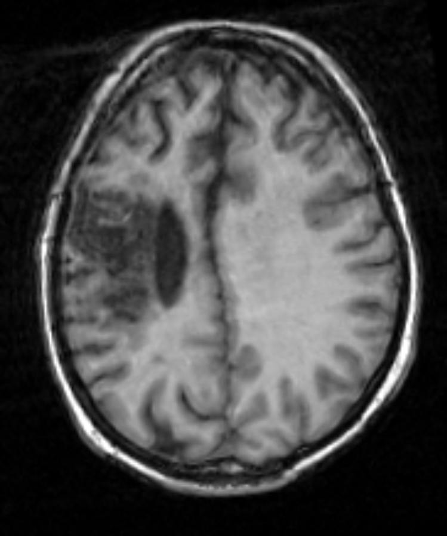{width=60%}

```md
## Радиологическое заключение по представленному МРТ-срезу головного мозга:

**1. Оценка качества изображения:**
Снимок представляет собой аксиальный срез головного мозга, выполненный, вероятно, по T2-взвешенной или FLAIR последовательности (судя по высокой интенсивности сигнала в субарахноидальном пространстве и желудочках). Качество визуализации достаточно хорошее, структура головного мозга хорошо различима. Визуализируются полушария, желудочки, базальные ганглии, таламус, внутренние капсулы. Разрешение позволяет оценить морфологию и интенсивность сигнала в исследуемых структурах. Артефактов движения или металлических наводок не выявлено. Снимок пригоден для оценки представленной патологии.

**2. Наличие или отсутствие патологии:**
На представленном срезе выявлено очаговое изменение в веществе головного мозга.

**3. Локализация:**
Очаг расположен в правой височной доле, в области базальных ганглиев (вероятно, в области скорлупы таламуса или хвостатого ядра).

**4. Характер и характеристики изменений:**
Очаг имеет неправильную, неровную форму. Размеры оценить сложно из-за двумерности среза, но он занимает значительный объем, простираясь от внутренней капсулы к латеральной поверхности височной доли. Интенсивность сигнала в очаге на T2-взвешенном/FLAIR изображении повышенная (гиперинтенсивный), что свидетельствует о высоком содержании воды, отеке или дегенеративных изменениях. Визуализируется перифокальный отек, выраженный в виде гиперинтенсивного ореола вокруг очага. Наблюдается умеренный масс-эффект, проявляющийся в виде сдавления окружающих структур и, возможно, небольшого смещения срединных структур влево.

**5. Дифференциальный диагноз и возможные причины:**
Учитывая локализацию, размеры, форму, высокую интенсивность сигнала на T2/FLAIR и наличие перифокального отека и масс-эффекта, следует рассматривать следующие возможности:
*   **Новообразование:** Первичная опухоль головного мозга (глиома, медуллобластома, эпендимома, лимфома) или метастатическое образование.
*   **Воспалительное/инфекционное поражение:** Абсцесс головного мозга (бактериальный, грибковый, паразитарный) или очаг демиелинизации (например, при рассеянном склерозе, но обычно очаги меньше и имеют другую локализацию, хотя возможны варианты).
*   **Инсульт:** Кровоизлияние (гематома) в острой или подострой фазе (но обычно гематомы гиперинтенсивны на T1 и гипоинтенсивны на T2/FLAIR, хотя возможны варианты). Ишемический инсульт в стадии наложения (но обычно более четкие границы).
*   **Травматическое изменение:** Посттравматическая киста, гематома.

**6. Дальнейшие рекомендации:**
Для уточнения диагноза и определения дальнейшей тактики лечения необходимо:
*   Провести МРТ головного мозга с контрастным усилением (в/в введение гадолиния) для оценки васкуляризации очага (особенно важно для дифференциации новообразования, абсцесса, воспалительного процесса).
*   Оценить динамику изменений на контрольных МРТ через определенный промежуток времени (например, через 1-3 месяца), особенно если контрастирование не дало однозначного ответа.
*   При необходимости, выполнить КТ головного мозга для оценки плотности образования (например, для исключения гематомы или выявления кальцинатов).
*   Рекомендовать консультацию невролога и, возможно, нейрохирурга для определения дальнейшего ведения пациента.
*   Рассмотреть возможность проведения биопсии очага при отсутствии четкой диагностики.
```

#### Анализ снимка pathology-05

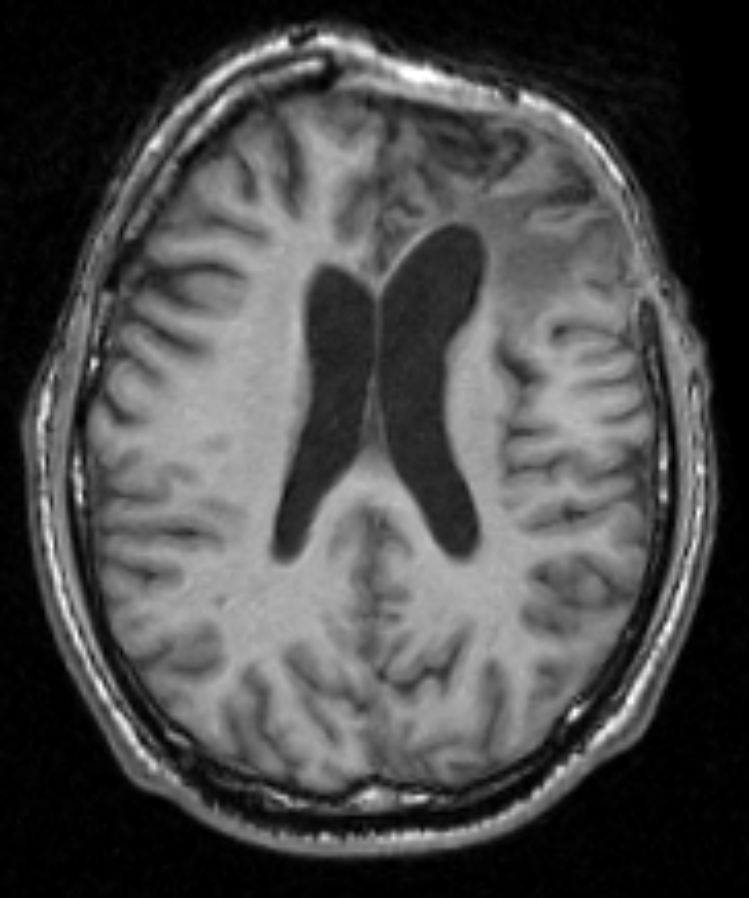{width=60%}

```md
## Радиологическое заключение по представленному МРТ-срезу головного мозга:

**1. Оценка качества изображения:**
Представлен аксиальный МРТ-срез головного мозга. Качество визуализации удовлетворительное, структура головного мозга различима. Визуализируются полушария, желудочки, базальные ганглии. На изображении присутствует артефакт от металлической накладки (вероятно, от очков) в области лба справа, перекрывающий часть кости. Срез, вероятно, выполнен по T2-взвешенной последовательности (судя по высокой интенсивности сигнала в желудочках и субарахноидальном пространстве). Пригодность снимка для оценки представленных изменений достаточная, но артефакт ограничивает оценку костных структур и прилегающих тканей в правой передней части головы.

**2. Наличие или отсутствие патологии:**
На представленном срезе выявлены выраженные изменения в области желудочковой системы головного мозга.

**3. Локализация:**
Изменения затрагивают боковые желудочки, III желудочек и межжелудочковые отверстия (отверстие Монро). Поражение двустороннее, симметричное.

**4. Характер и характеристики изменений:**
Визуализируется значительное расширение боковых желудочков и III желудочка (вентрикуломегалия). Угол между боковыми желудочками (передний рог) выглядит увеличенным. Визуализируются расширенные субарахноидальные пространства (гидроцефалия). Срединные структуры (мозолистое тело, таламусы) не смещены. Масс-эффекта со стороны очаговых образований не определяется.

**5. Дифференциальный диагноз и возможные причины:**
Представленная картина гидроцефалии (расширение желудочковой системы) может быть вызвана различными причинами:
*   **Обструктивная гидроцефалия:** Нарушение оттока ликвора из-за блокады (например, опухоль, киста, спайки, аномалия развития).
*   **Коммуникативная гидроцефалия:** Нарушение всасывания ликвора (например, менингит, субарахноидальное кровоизлияние, посттравматическая гидроцефалия) или повышенная продукция ликвора (редко).
*   **Нормальное давление гидроцефалия (НДГ):** Характерна для пожилых людей, часто связана с атрофией головного мозга.
*   **Врожденная гидроцефалия:** Аномалии развития желудочковой системы.

Учитывая симметричность расширения желудочков, можно предположить нарушение коммуникации (коммуникативная гидроцефалия) или нарушение всасывания ликвора, либо НДГ (если пациент пожилой). Обструктивная гидроцефалия менее вероятна из-за симметрии, но не исключена, особенно если блокада расположена вблизи межжелудочкового отверстия.

**6. Дальнейшие рекомендации:**
Для уточнения причины гидроцефалии и определения дальнейшей тактики необходимы:
*   МРТ головного мозга с акцентом на оценку цистерн, субарахноидального пространства, аномалий развития желудочковой системы, выявление возможных причин обструкции (опухоль, киста, стеноз акведука).
*   При необходимости – МР-ангиография/КТ-ангиография для оценки сосудов головного мозга.
*   Консультация невролога.
*   Возможно, потребуется люмбальная пункция для измерения давления ликвора и цитологического/биохимического анализа.
*   Повторные исследования (МРТ/КТ) для оценки динамики.
```


#### Анализ снимка normal-01

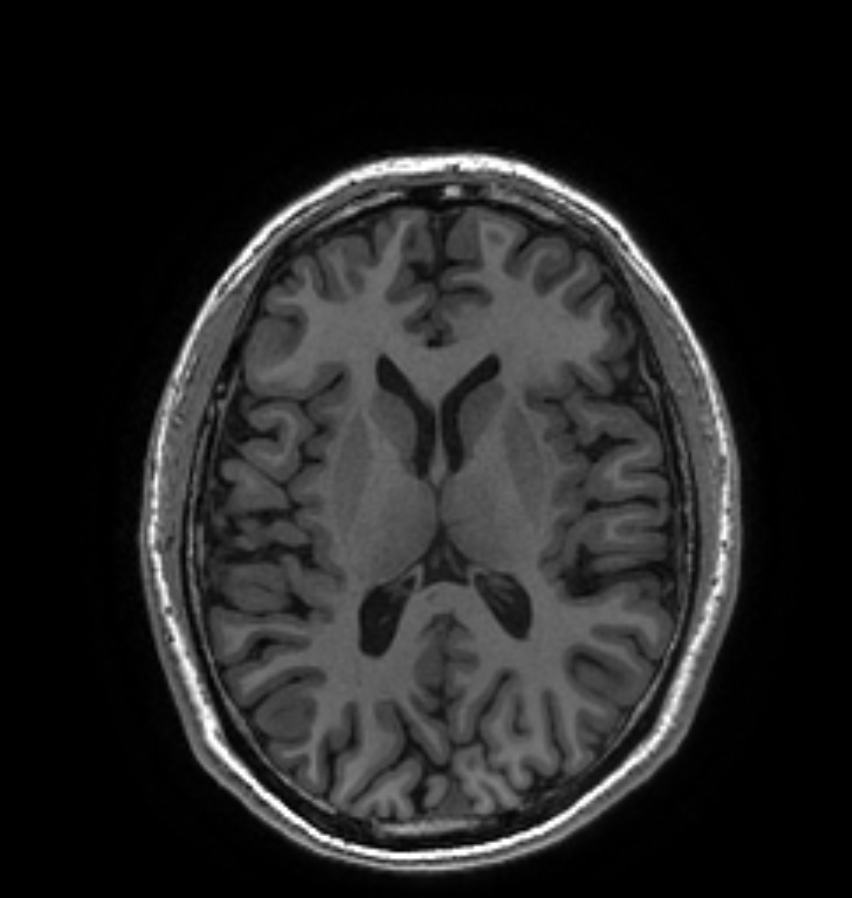{width=60%}

```md
## Радиологическое заключение по МРТ головного мозга

**1. Оценка качества изображения:**

Снимок представляет собой аксиальный Т2-взвешенный МРТ-срез головного мозга. Качество изображения хорошее, визуализация анатомических структур удовлетворительная. Разрешение позволяет оценить структуру белого и серого вещества, желудочковую систему. Артефактов движения или металлических наводок не выявлено. Снимок пригоден для оценки.

**2. Наличие или отсутствие патологии:**

На представленном срезе не выявлено очевидных патологических изменений. Желудочки головного мозга кажутся не расширенными, симметричными. Белое и серое вещество выглядят однородно, без признаков выраженных очаговых изменений.

**3. Локализация:**

Не применимо, так как патология не выявлена.

**4. Характер и характеристики изменений:**

Не применимо, так как патология не выявлена.

**5. Дифференциальный диагноз и возможные причины:**

Не применимо, так как патология не выявлена. Представленный срез соответствует возрастной норме.

**6. Дальнейшие рекомендации:**

Поскольку патологии не выявлено на представленном срезе, а он демонстрирует только один уровень сканирования, для полной оценки головного мозга рекомендуется провести полноценное МРТ исследование с использованием нескольких последовательностей (Т1-взвешенные, FLAIR, DWI, возможно, с контрастированием) в зависимости от клинических показаний. Это позволит исключить патологию, которая может быть не видна на представленном аксиальном Т2-взвешенном срезе.
```


#### Анализ снимка normal-02

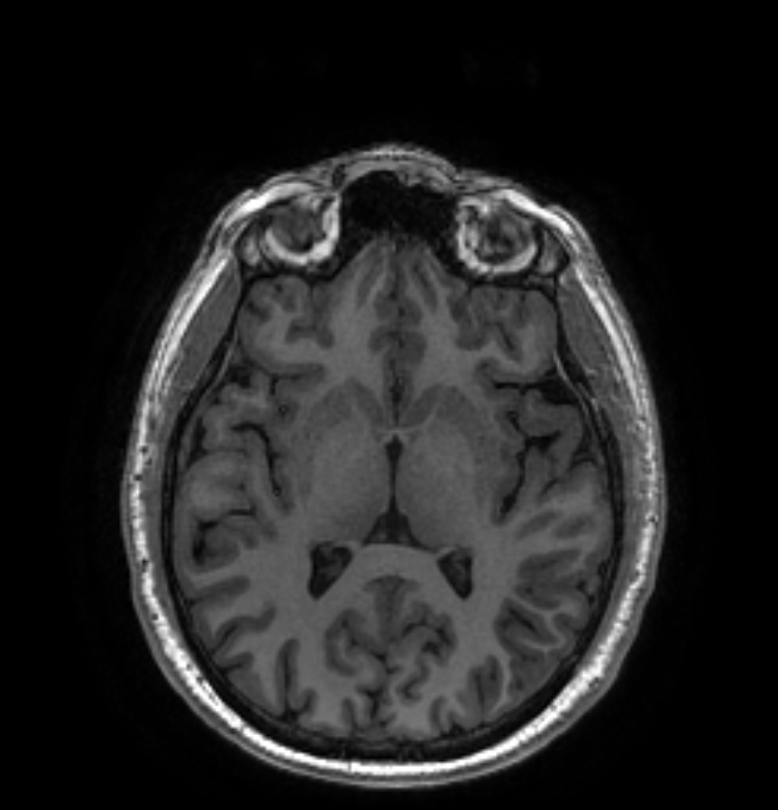{width=60%}

 ```md
 Хорошо, я выступлю в роли опытного радиолога и проанализирую представленный МРТ снимок среза головного мозга.

**1. Оценка качества изображения:**

*   **Понятность:** Снимок достаточно понятен. Видны основные структуры головного мозга: полушария, желудочки, ствол мозга, мозжечок (частично).
*   **Качество:** Качество изображения хорошее. Четко видны границы между серым и белым веществом, структура спинного мозга (если он виден на срезе), желудочки. Видна текстура ткани мозга. Отсутствуют явные артефакты, которые бы мешали интерпретации.

**2. Наличие патологии:**

На представленном срезе, визуально, **не выявлено явных грубых патологических изменений**, таких как:

*   Очевидные очаги демиелинизации (множественные, крупные).
*   Объемные образования (опухоли, гематомы).
*   Выраженные признаки инсульта (большие области ишемии/кровоизлияния).
*   Значительное смещение срединных структур.
*   Выраженная гидроцефалия.
*   Признаки воспаления (менингит).

**3. Локализация:**

Срез, судя по изображению, представляет собой **аксиальную (горизонтальную) проекцию** головного мозга, вероятно, на уровне таламусов или немного ниже. Точная локализация затруднена без информации о плоскости сканирования, но основные структуры, упомянутые выше, хорошо видны.

**4. Характер изменений:**

*   **Незначительные изменения плотности:** Можно заметить небольшие различия в интенсивности сигнала в белом веществе, которые могут быть связаны с возрастными изменениями (лейкоареоз) или незначительными сосудистыми изменениями. Однако, без сравнения с предыдущими снимками или клинической информацией, сложно оценить их значимость.
*   **Размеры желудочковой системы:** Желудочки выглядят пропорциональными размерам мозга, без явных признаков расширения.
*   **Симметрия полушарий:** Полушария выглядят симметричными, без видимого атрофического или отекового компонента.

**5. Возможные причины патологий:**

Поскольку явных грубых патологий не выявлено, говорить о конкретных причинах сложно. Незначительные изменения в белом веществе могут быть связаны с:

*   Возрастными изменениями.
*   Хронической сосудистой недостаточностью (например, гипертония).
*   Микроангиопатией.

**6. Дальнейшие рекомендации:**

*   **Необходим полный комплекс МРТ головного мозга:** Представлен только один срез. Для полноценной оценки требуется сканирование во всех плоскостях (аксиальная, сагиттальная, корональная) и, возможно, специальные последовательности (например, DWI, FLAIR, GRE/SWI).
*   **Клиническая информация:** Необходимо учитывать возраст пациента, жалобы, анамнез (перенесенные заболевания, травмы, операции).
*   **Сравнение с предыдущими снимками:** Если есть предыдущие МРТ, необходимо их сравнить для оценки динамики изменений.
*   **Консультация невролога:** Для интерпретации результатов МРТ в контексте клинической картины.

**7. Заключение:**

На представленном единственном аксиальном срезе МРТ головного мозга **не выявлено очевидных грубых патологических изменений**. Однако, для полной и достоверной оценки необходимо проведение полного протокола МРТ головного мозга и сопоставление результатов с клиническими данными.
```


#### Анализ снимка normal-03
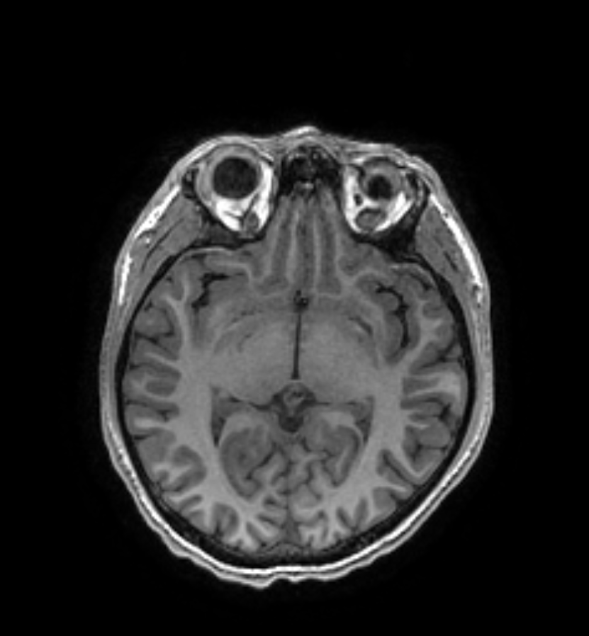{width=60%}

```md
## Радиологическое заключение по МРТ головного мозга

**1. Оценка качества изображения:**

Снимок представляет собой аксиальный Т2-взвешенный МРТ-срез головного мозга. Качество изображения удовлетворительное. Визуализация анатомических структур достаточная для базовой оценки. Разрешение позволяет оценить структуру белого и серого вещества, желудочковую систему, ствол мозга и мозжечок. Артефактов движения или металлических наводок не выявлено. Снимок пригоден для оценки.

**2. Наличие или отсутствие патологии:**

На представленном срезе не выявлено явных патологических изменений. Визуализируются структуры головного мозга, включая полушария, таламусы, желудочки, ствол мозга и мозжечок. Нет признаков выраженных очаговых изменений, кровоизлияния, опухоли или гидроцефалии.

**3. Локализация:**

Не применимо, так как патология не выявлена.

**4. Характер и характеристики изменений:**

Не применимо, так как патология не выявлена.

**5. Дифференциальный диагноз и возможные причины:**

Не применимо, так как патология не выявлена. Срез соответствует возрастной норме.

**6. Дальнейшие рекомендации:**

Поскольку патологии не выявлено на представленном срезе, а он демонстрирует только один уровень сканирования, для полной оценки головного мозга рекомендуется провести полноценное МРТ исследование с использованием нескольких последовательностей (Т1-взвешенные, FLAIR, DWI, возможно, с контрастированием) в зависимости от клинических показаний. Это позволит исключить патологию, которая может быть не видна на представленном аксиальном Т2-взвешенном срезе.
```


#### Анализ снимка normal-04

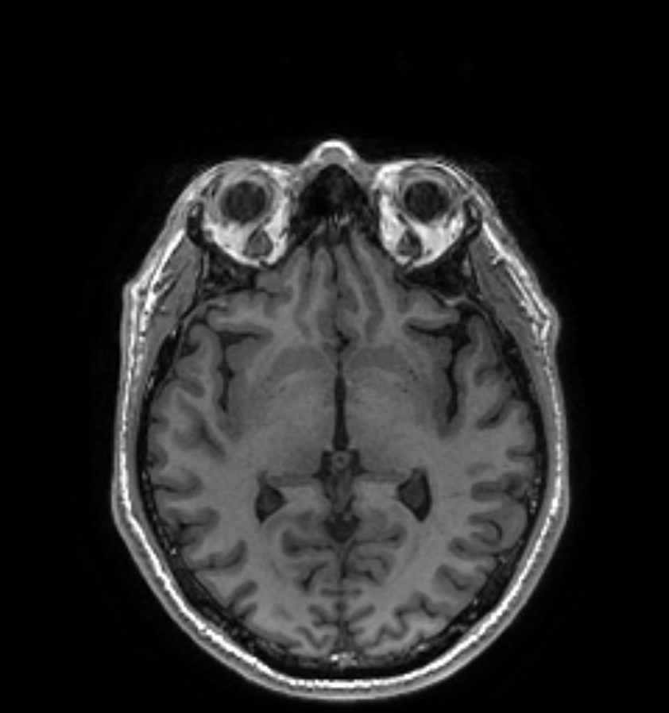{width=60%}

```md
## Радиологическое заключение по представленному МРТ-срезу головного мозга:

**1. Оценка качества изображения:**
Снимок представляет собой аксиальный (горизонтальный) срез головного мозга, вероятно, выполненный на уровне таламусов. Качество визуализации удовлетворительное, разрешение позволяет оценить основные структуры головного мозга. Визуализируются полушария, желудочковая система, мозжечок, ствол мозга. Не отмечается значительных артефактов движения или металлических наводок. Снимок пригоден для базовой оценки.

**2. Наличие или отсутствие патологии:**
На представленном срезе не выявлено явных признаков патологических изменений, таких как очаги демиелинизации, кровоизлияния, опухоли, выраженного отека или гидроцефалии. Визуализируются структуры головного мозга, соответствующие возрастной норме по расположению и интенсивности сигнала.

**3. Локализация:**
Не применимо, так как патологии не выявлено.

**4. Характер и характеристики изменений:**
Не применимо, так как патологии не выявлено.

**5. Дифференциальный диагноз и возможные причины:**
Снимок соответствует норме. Дифференциальный диагноз не требуется.

**6. Дальнейшие рекомендации:**
На основании представленного единственного среза нельзя сделать окончательное заключение о состоянии головного мозга. Рекомендуется предоставить полный комплекс МРТ головного мозга (аксиальные, сагиттальные, корональные срезы, T1, T2, FLAIR, DWI, GRE/SWI) для полноценной оценки и исключения патологии, которую невозможно увидеть на одном срезе. При наличии клинических симптомов рекомендуется консультация невролога.
```


#### Анализ снимка normal-05

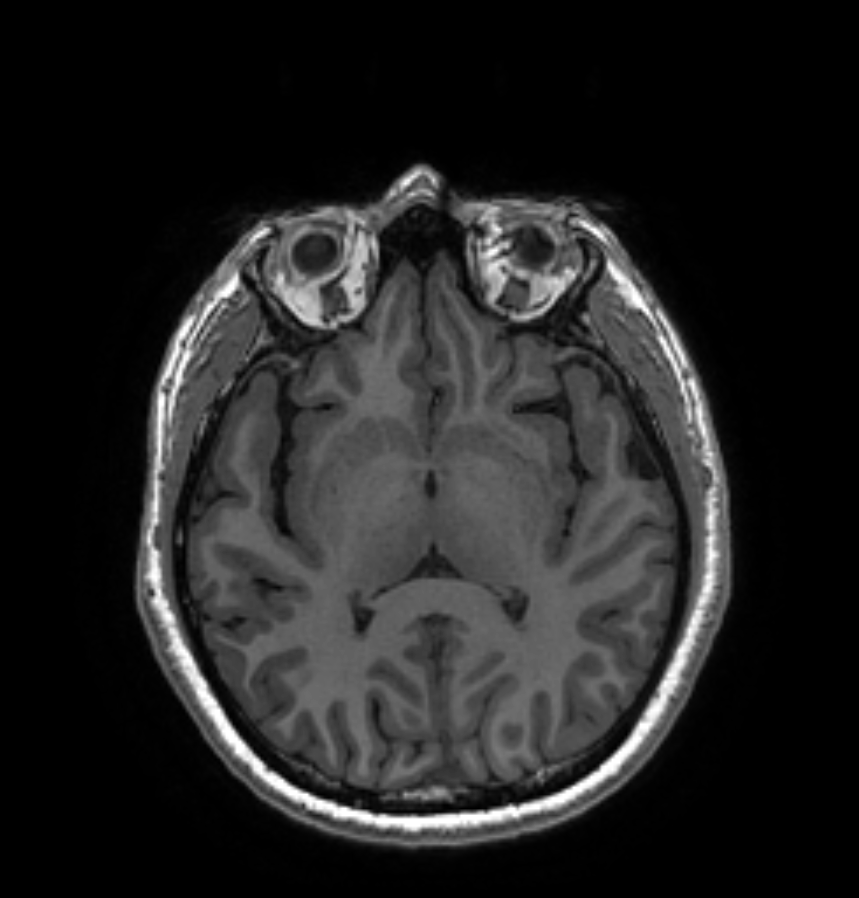{width=60%}


```md
## Радиологическое заключение по МРТ головного мозга

**1. Оценка качества изображения:**

Снимок представляет собой аксиальный Т2-взвешенный МРТ-срез головного мозга. Качество изображения хорошее. Визуализация анатомических структур достаточная, разрешение позволяет оценить структуру белого и серого вещества, желудочковую систему, ствол мозга и мозжечок. Артефактов движения или металлических наводок не выявлено. Снимок пригоден для оценки.

**2. Наличие или отсутствие патологии:**

На представленном срезе не выявлено явных патологических изменений. Визуализируются структуры головного мозга, включая полушария, таламусы, желудочки, ствол мозга и мозжечок. Нет признаков выраженных очаговых изменений, кровоизлияния, опухоли или гидроцефалии.

**3. Локализация:**

Не применимо, так как патология не выявлена.

**4. Характер и характеристики изменений:**

Не применимо, так как патология не выявлена.

**5. Дифференциальный диагноз и возможные причины:**

Не применимо, так как патология не выявлена. Срез соответствует возрастной норме.

**6. Дальнейшие рекомендации:**

Поскольку патологии не выявлено на представленном срезе, а он демонстрирует только один уровень сканирования, для полной оценки головного мозга рекомендуется провести полноценное МРТ исследование с использованием нескольких последовательностей (Т1-взвешенные, FLAIR, DWI, возможно, с контрастированием) в зависимости от клинических показаний. Это позволит исключить патологию, которая может быть не видна на представленном аксиальном Т2-взвешенном срезе.
```


### 10. Анализ результатов заключения модели

Модели было предложено 10 снимков (5 с патологией и 5 без патологий)

#### Таблица оценки

| Снимок | Эталон | Патология (модель) | Сторона / локализация (модель) | Кратко о находке | Совпадение |
| --- | --- | --- | --- | --- | --- |
| pathology-01 | очаг **справа**, лобно-центрально (глубоко) | да | **слева**, подкорково / глубокое белое вещество | образование ~2–2,5 см, перифокальный отёк, масс-эффект; ДД: опухоль / абсцесс / инфаркт | патология ✓, сторона ✗ |
| pathology-02 | очаг **слева**, медиально-лобная / поясная (прибл.) | да | **слева**, базальные ганглии / таламус | неоднородное образование, отёк, смещение бокового желудочка | ✓ |
| pathology-03 | очаг **слева**, лобная доля | да | **слева**, лобная доля | крупное образование, неровные контуры, отёк, смещение срединных структур | ✓ |
| pathology-04 | очаг **слева**, височно-теменно-островковая | да | **справа**, височная доля | очаг неправильной формы, гиперинтенсивный, отёк, умеренный масс-эффект | патология ✓, сторона ✗ |
| pathology-05 | очаг **справа**, лобная доля | отмечены «выраженные изменения» | не указана (двусторонне) | описал расширение желудочков (вентрикуломегалия / гидроцефалия) вместо очага | находка ✗ |
| normal-01 | норма | нет | — | без очаговых изменений | ✓ |
| normal-02 | норма | нет | — | норма; единичные изменения белого вещества (возрастные) | ✓ |
| normal-03 | норма | нет | — | без очаговых изменений | ✓ |
| normal-04 | норма | нет | — | соответствует возрастной норме | ✓ |
| normal-05 | норма | нет | — | без очаговых изменений | ✓ |

**Итог по выборке (10 снимков):**

- Патология отмечена (как «изменения»): **5/5**.
- Сторона поражения указана верно: **2/5** (`pathology-02`, `pathology-03`); ошибочна: **2/5** (`pathology-01`, `pathology-04`); очаг не локализован (описана иная находка): **1/5** (`pathology-05`).
- Норма верно классифицирована как «без патологии»: **5/5** (ложноположительных нет).
- Систематическая ошибка: модель называет последовательность T2-взвешенной, тогда как снимки — T1w.

> Эталонная сторона/локализация — из масок датасета, ориентировочная (см. маски датасета ds007212).


#### Средняя загрузка ресурсов ПК

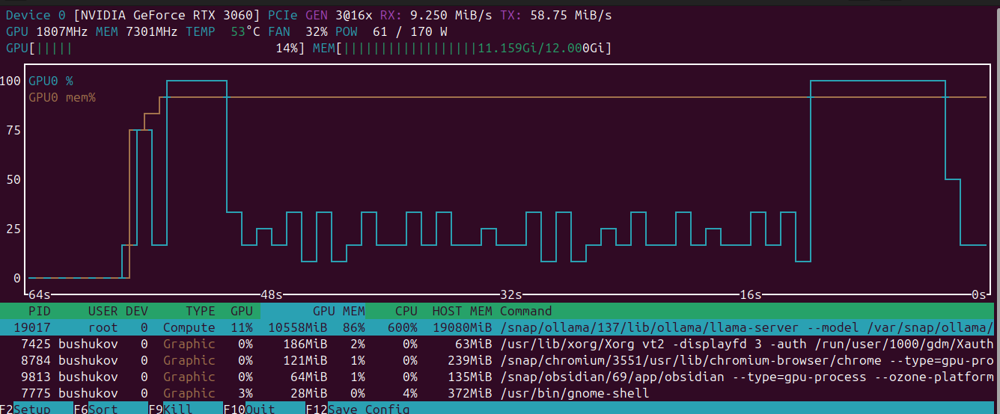


#### Заключение
```md
Тест на 10 срезах (5 с патологией, 5 — норма) показал, что `medgemma:27b` **уверенно различает наличие и отсутствие очаговой патологии**: все 5 патологических снимков отмечены как «изменения» (5/5), а на всех 5 нормальных модель не выдумала очаг (0 ложноположительных). Это ключевой вывод — модель **как минимум явно видит патологию** и не «галлюцинирует» там, где её нет.

Точность же **локализации заметно ниже**: сторону очага модель назвала верно лишь в 2 из 5 случаев, ещё в 2 — ошиблась стороной, а в одном описала не относящуюся к очагу находку (гидроцефалию). Дополнительно все срезы были интерпретированы как **T2-взвешенные**, хотя данные — **T1w**: модель опирается на визуальный паттерн, а не на фактическую последовательность сканирования.

Отсюда главная мысль: заключение модели — это **скрининговый, а не диагностический** результат. Оно помогает быстро обратить внимание на снимок («здесь что-то есть»), но не заменяет специалиста. Поставить точное заключение — определить нозологию, точную локализацию, оценить динамику и выбрать тактику — может только **врач-радиолог** (интерпретация изображений) в связке с **нейрохирургом / неврологом** (клинический контекст и объём вмешательства). Одиночный 2D-срез ограничивает любого: диагноз ставится по полному объёму, нескольким последовательностям и проекциям.

Тем не менее подход **имеет практическую ценность** как вспомогательное звено: черновое «второе мнение» и приоритизация находок при больших объёмах исследований. Для реального внедрения необходимы:

- тестирование на **большей и репрезентативной выборке** (разные возраст/пол, сканеры, учреждения, типы патологий);
- валидация в **клиническом процессе** совместно со специалистами по лучевой диагностике и хирургии;
- подача данных в том виде, в котором модель обучалась (правильные последовательности и проекции, а не одиночные PNG).

**Итог:** `medgemma:27b` — перспективный **помощник** для предварительного анализа и скрининга, но **не замена** врача; внедрять её следует только в связке с радиологом и хирургом и после проверки на репрезентативной клинической выборке.
```


#### План дальнейшего тестирования

```md
В следующей части планируется расширить тест и приблизить его к реальному клиническому сценарию:

- **Полный объём DICOM, а не один срез.** Разобрать файл `.dcm` целиком и подавать модели не отдельный PNG, а серию срезов по всему объёму — чтобы оценка шла по всему исследованию, а не по одному уровню.
- **Разные проекции и последовательности.** Добавить аксиальные, сагиттальные и коронарные проекции и разные последовательности (T1, T2, FLAIR, DWI), чтобы проверить, влияет ли корректная модальность на точность и на определение стороны (в текущем тесте модель все срезы назвала T2, хотя данные — T1w).
- **Разные промпты.** Сравнить результаты при нескольких формулировках запроса — от короткого «есть ли патология» до развёрнутого радиологического заключения — и оценить воспроизводимость ответа и склонность к галлюцинациям.
- **Большая выборка.** Прогнать больше исследований (с патологией и без), при возможности — несколько локальных моделей и их версий.

Цель — понять, насколько стабильно и точно `medgemma:27b` работает на полноценных DICOM-данных и как формулировка промпта влияет на результат.
```
